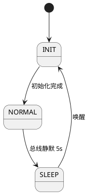
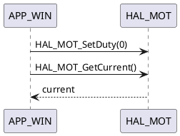
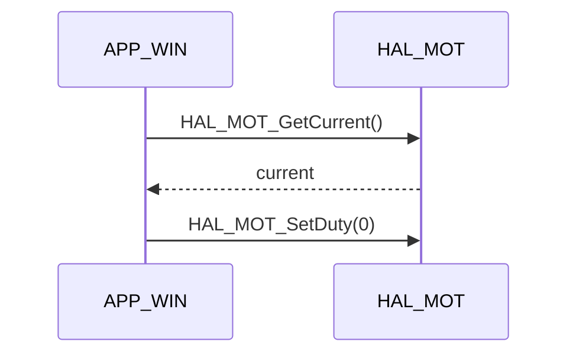

# 软件架构设计规格说明书（示例：车窗控制 WIN_P001）

## 1 引言

### 1.1 文档范围

本文件为评测夹具，结构对齐 AU-QR-R&D-032（sad-generator 输出形式）。

## 5 实时分析

### 5.1 进程识别 Processes Identification

| 任务名 | 触发 | 周期(ms) | 优先级 | 承载组件 | 职责 |
|---|---|---|---|---|---|
| Task_10ms | 周期 | 10 | 2 | APP_WIN | 车窗控制 |

### 5.2 时基识别 Timing bases identification

| 时基 | 用途 |
|---|---|
| 1ms | 调度节拍 |
| 10ms | 控制周期，防夹判定窗口 ≤ 30ms |

### 5.3 软件运行模式 Software Operating Modes

| 序号 | 起始状态 | 跳转状态 | 条件 |
|---|---|---|---|
| 1 | INIT | NORMAL | 初始化完成 |
| 2 | NORMAL | SLEEP | 总线静默 ≥ 5s |
| 3 | SLEEP | INIT | 唤醒报文 |

### 5.5 共享资源 Shared Resources

电机 PWM 通道由 HAL_MOT 独占。

## 7 架构设计

### 7.1 实时架构

#### 7.1.1 中断 Interrupts

霍尔中断响应 ≤ 50us。

### 7.3 内存消耗 Memory Consumption

ROM ≤ 64KB，RAM ≤ 8KB。

## 8 软件组件

### 8.1 应用层 APP

#### 8.1.1 APP_WIN 车窗控制组件

##### 资源约束

ROM consumption must not exceed 4096 Byte
RAM consumption must not exceed 512 Byte

##### 外部接口(依赖)

| 服务 | 说明 |
|---|---|
| uint16 HAL_MOT_GetCurrent(void) | 读电机电流 |
| void HAL_MOT_SetDuty(uint8 duty) | 设定占空比 |

##### 组件 API

| 服务名 | 原型/签名 | 方向 | 描述 |
|---|---|---|---|
| WIN_Init | void WIN_Init(void) | 被调用 | 初始化 |
| WIN_MainFunction | void WIN_MainFunction(void) | 被调用 | 10ms 周期任务 |
| WIN_GetPosition | uint8 WIN_GetPosition(void) | 被调用 | 车窗位置 0..100 % |

### 8.2 硬件抽象层 HAL

#### 8.2.1 HAL_MOT 电机驱动组件

##### 资源约束

ROM consumption must not exceed 2048 Byte
RAM consumption must not exceed 128 Byte

##### 组件 API

| 服务名 | 原型/签名 | 方向 | 描述 |
|---|---|---|---|
| HAL_MOT_GetCurrent | uint16 HAL_MOT_GetCurrent(void) | 被调用 | 电流 mA |
| HAL_MOT_SetDuty | void HAL_MOT_SetDuty(uint8 duty) | 被调用 | 占空比 0..100 |

## 9 时序管理

### 9.1 初始化时序 Initialization Sequence

### 9.4 时序图 Sequence Diagrams

#### 9.4.1 防夹时序 Anti-pinch Sequence

